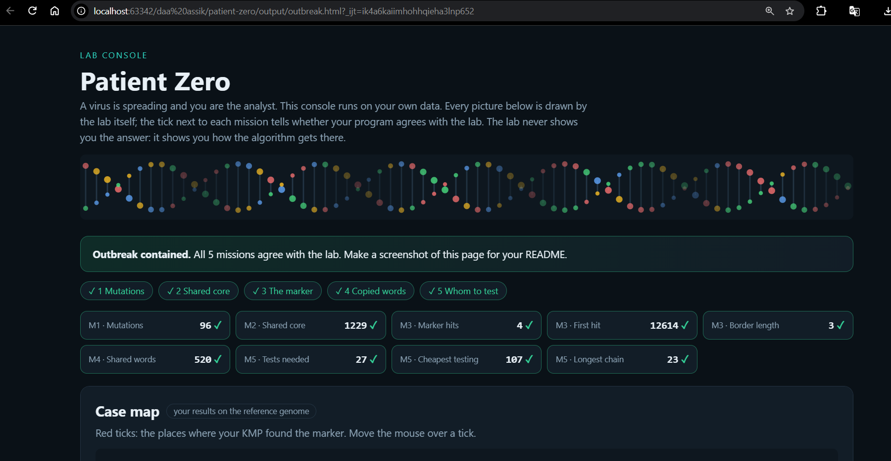

# Assignment 4. Patient Zero

Student ID: 250525
Name: Tangzharyk Rakhmetov
Group: SE - 2532

This file is the report. Fill it in as you go. How to start: `START_HERE.md`. The task: `docs/Assignment4.pdf`.

## Program output

The 9 lines your program prints on your data (`java -cp out Main`):

    Mutations: 96
    Shared core: 1229
    Marker hits: 4
    First hit: 12614
    Border length: 3
    Shared words: 520
    Tests needed: 27
    Cheapest testing: 107
    Longest chain: 23

My outbreak report (a screenshot of `output/outbreak.html`):

## Questions

Answer in your own words, two or three sentences each.

**Mission 1. What does the cell d[i][j] of your table mean, and how is it computed from other cells?**
The cell `d[i][j]` represents the minimum edit distance (number of mutations) between the prefix of strain A of length `i` and the prefix of strain B of length `j`. It is computed by taking the minimum cost of three operations: a deletion (`d[i-1][j] + 1`), an insertion (`d[i][j-1] + 1`), or a substitution/match (`d[i-1][j-1] + cost`, where cost is 0 if the characters match and 1 if they differ).

**Mission 2. How is the longest common subsequence different from the longest common substring? My Shared core is bigger than the number of letters that are the same at the same place: why?**
A longest common subsequence (LCS) allows characters to be separated by other characters, while a substring requires characters to be strictly contiguous. The Shared core is larger because the LCS algorithm accounts for insertions and deletions, finding matching character sequences even if they have shifted to different indices in the new strain.

**Mission 3. What does the prefix function tell you, and why does the pointer in the text never go back in KMP? What is the Border length of my marker and what does it mean?**
The prefix function `pi[i]` stores the length of the longest proper prefix of the pattern `p[0..i]` that is also a suffix. In KMP, the text pointer never goes back because when a mismatch occurs, the prefix array tells us exactly how much of the already matched prefix can be reused, allowing us to just slide the pattern forward. The "Border length" is the value of `pi[marker.length - 1]`, indicating the longest prefix of the entire marker that is identical to its suffix.

**Mission 4. Why must you compare the letters after the hashes are equal? What happens to the cost of Rabin-Karp if many windows have the same hash?**
We must compare the actual letters because different words can generate the same hash value (a hash collision). If many windows have the same hash, the algorithm spends O(K) time verifying each collision letter-by-letter, which degrades the overall time complexity from O(N) towards O(N * K) in the worst case.

**Mission 5. What are the two states of a person in your DP, and how do you get the answer for a person from its children? Why does a greedy "test the person with most links first" not always give the cheapest answer?**
The two states for a person are the minimum subtree cost if the person IS tested, and the cost if they ARE NOT tested. If a person is not tested, all their children must be tested; if they are tested, we simply take the minimum of the two states (tested or not) for each child. A greedy approach based on the highest number of links fails because it ignores the actual dollar cost of the tests; it might select a highly connected but extremely expensive person instead of a cheaper combination of less connected people.

## AI use

I used Gemini to explain the theoretical differences between LCS and substrings, to clarify the DP state transitions for the tree algorithm, and to help structure the written answers and complexity table in this README.

## Timing (Mission 7)

Milliseconds, average of 3 runs, from `java -cp out Bench`.

| test | size | time |
|---|---|---|
| naive search | 20 000 / 40 000 / 80 000 | 105,4 / 197,6 / 390,6 |
| KMP | 20 000 / 40 000 / 80 000 | 4,0 / 2,1 / 0,8 |
| edit distance | 500 / 1000 / 2000 / 4000 | 13,5 / 13,9 / 34,1 / 141,7 |

What do the numbers say about how the time grows? When you double the size, by how much does each time grow? Two or three sentences.
For naive search, the time grows roughly linearly (doubling the size doubles the time) because its practical complexity is O(N) in typical text. For the edit distance, the time quadruples when the size doubles (e.g., from ~34 ms to ~141 ms between 2000 and 4000), confirming its O(N^2) quadratic time complexity.

## Complexity

n is the length of the text (or of a strain), m the length of the pattern, k the length of the window, v the number of people. Fill in every algorithm you wrote.

| algorithm | time | space | assumptions |
|---|---|---|---|
| Edit distance | O(n * m) | O(n * m) | A full 2D table is allocated without space optimization. |
| LCS | O(n * m) | O(n * m) | A full 2D table is allocated without space optimization. |
| Prefix function and KMP | O(n + m) | O(m) | Alphabet size is a small constant; space is dominated by the `pi` array. |
| Rabin-Karp (shared words) | O(n + m) expected | O(m) | Few hash collisions occur; hashing map overhead is O(1) expected. Worst-case time is O(n * k). |
| Tree DP | O(v) | O(v) | Tree operations use adjacency lists; recursion depth is at most v. |

## Before you submit

- The four files in `data` and the screenshot `output/outbreak.png` are in the repository.
- `java tools/Check.java` shows all examples right.
- This README is filled in, the program output and the section AI use included.
- The work is pushed to main (at least one commit per mission) and the repository is public.
- The link is attached in Moodle.